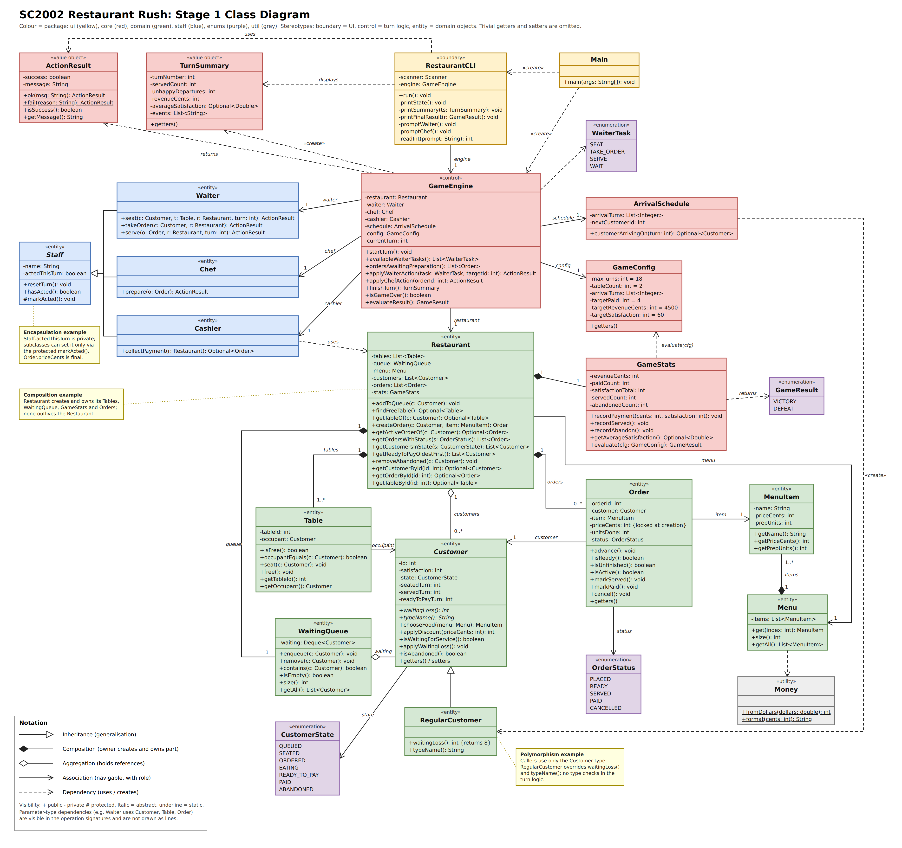

# Restaurant Rush

A turn based restaurant management game in Java, built for NTU SC2002 Object Oriented Design and Programming.

You are the manager. Six customers arrive over 18 turns, and each turn you tell the Waiter and the Chef what to do. The Cashier works on its own. Customers lose patience while they wait and walk out at zero. At the end of turn 18 you win if at least 4 customers paid, revenue is at least $45.00 and the average satisfaction of paying customers is at least 60.

This is **Stage 1** (git tag `stage-1`): Regular customers, the three item menu, Waiter, Chef, Cashier, tables, orders, the waiting queue, the full turn sequence, and both endings. No Stage 2 or Stage 3 features are present.



## Quick start

Requires JDK 11 or newer. No libraries, no network.

```bash
# Linux / macOS
javac -d out $(find src -name "*.java")
java -cp out app.Main
```

```bat
:: Windows
javac -d out src\app\*.java src\core\*.java src\domain\*.java src\enums\*.java src\staff\*.java src\ui\*.java src\util\*.java
java -cp out app.Main
```

Input is one number per line, so a whole game can be replayed from a file:

```bash
java -cp out app.Main < tests/victory.txt
java -cp out app.Main < tests/defeat.txt
```

## What a turn looks like

```
========== Turn 2 / 18 ==========
Revenue: $0.00   Paid customers: 0   Avg satisfaction (paid): N/A
Waiting queue: (empty)
Tables:
  Table 1: Customer 1 (SEATED)
  Table 2: free
Customers:
  C1 Regular  state=SEATED  sat=92
Staff tasks available:
  Waiter: [TAKE_ORDER, WAIT]
  Chef:   [WAIT]
  Cashier: automatic (oldest READY_TO_PAY customer)
Waiter: 1=Seat  2=Take order  3=Serve  4=Wait > 2
  Customer id to take order from > 1
  Customer 1 orders Salad (Order #1, 1 prep unit(s)).
Chef:   1=Prepare order  2=Wait > 1
  Order id to prepare > 1
  Chef works on Order #1 (1/1 units). It is now READY.
---------- End of turn 2 ----------
  Served: 0   Unhappy departures: 0   Revenue: $0.00   Avg satisfaction (paid): N/A   Turns used: 2/18
```

An invalid choice (wrong id, serving an order that is not READY, a letter instead of a number) prints the reason and asks again. The staff member's task for the turn is not used up.

## Game rules as implemented

The brief's six steps run in this order every turn.

| Step | Where it lives | What happens |
|---|---|---|
| 1 Arrivals | `GameEngine.startTurn` → `ArrivalSchedule` | A Regular customer joins the queue at satisfaction 100 on turns 1, 4, 7, 10, 13 and 16 |
| 2 Manager choices | `RestaurantCLI` → `GameEngine.applyWaiterAction` / `applyChefAction` | Waiter: seat, take order, serve one READY order, or wait. Chef: advance one PLACED order by one unit, or wait |
| 3 Kitchen and serving | `Waiter`, `Chef`, `Order.advance` | Waiter always acts before Chef, so an order that becomes READY this turn is served next turn at the earliest |
| 4 Eating and payment | `GameEngine.finishTurn`, `Cashier` | Cashier pays out the oldest READY_TO_PAY customer first, then customers served on an earlier turn become READY_TO_PAY. Payment adds the bill, marks PAID, frees the table |
| 5 Waiting and abandonment | `Customer.applyWaitingLoss`, `Restaurant.removeAbandoned` | Every customer not yet served loses 8 (floor 0). At 0 they leave: order cancelled, table freed, nothing added to revenue |
| 6 Result | `GameStats.evaluate` | After turn 18: VICTORY if all three targets are met, else DEFEAT |

The payment ordering in step 4 is what makes a customer who becomes READY_TO_PAY this turn pay next turn. The worked example in the brief (Pasta customer: seated turn 1, pays turn 6) reproduces exactly.

### Decisions the brief left to me

**Food choice.** Customers choose, never the manager. `Customer.chooseFood(menu)` uses a deterministic rule: menu index = (customer id − 1) mod 3, so customers 1 to 6 order Salad, Burger, Pasta, Salad, Burger, Pasta. The choice is printed when the order is taken. It is a method on `Customer` so later customer types can override it without any type checks in the engine.

**Seating.** The manager picks which queued customer to seat; the Waiter puts them at the lowest numbered free table. Who gets seated is the real decision, the table number is not.

**Payment order.** `Restaurant.getReadyToPayOldestFirst()` sorts by the turn the customer became READY_TO_PAY, then by id.

**Money.** Prices are integer cents in `MenuItem`, locked into `Order.priceCents` when the order is taken via `Customer.applyDiscount` (full price for Regular). `Money.format` prints dollars with two decimals.

## Project layout

```
src/
  app/     Main                         wires everything together, starts the UI
  ui/      RestaurantCLI                collects choices, prints state. No rules here
  core/    GameEngine                   runs the six turn steps
           GameConfig                   base setting from the brief, in one place
           ArrivalSchedule              which customer arrives on which turn
           GameStats                    revenue, counts, average, win check
           TurnSummary                  read only end of turn report
           ActionResult                 success or a reason, returned to the UI
  domain/  Restaurant                   tables, queue, customers, orders, stats
           Table, WaitingQueue, Menu, MenuItem, Order
           Customer (abstract), RegularCustomer
  staff/   Staff (abstract), Waiter, Chef, Cashier
  enums/   CustomerState, OrderStatus, WaiterTask, GameResult
  util/    Money
docs/      class diagram (png, svg, editable drawio)
tests/     victory.txt, defeat.txt      scripted runs
```

## Design notes

**Rules out of the UI.** `RestaurantCLI` only reads numbers and prints state. It never decides whether an action is allowed; it calls the engine and prints whatever `ActionResult` or `TurnSummary` comes back. `GameEngine` contains no `System.out`.

**Rules live with their data.** `Order.advance()` decides when a dish is READY. `Customer.applyWaitingLoss()` and `isAbandoned()` decide who loses points and who walks out. `Staff` enforces one task per turn through `hasActed()` / `markActed()`. `GameEngine` only sequences the steps and looks up objects by id.

**Dispatch through the customer, not type checks.** `Customer` is abstract with three hooks: `waitingLoss()`, `chooseFood(menu)` and `applyDiscount(priceCents)`. `RegularCustomer` is the only concrete type in Stage 1. Stage 2 adds VIP and Critic by overriding those hooks, and the engine does not change.

**Why `ActionResult` instead of exceptions.** Invalid manager input is expected, not exceptional. A small value object carrying success plus a message lets the UI re prompt without knowing any rules.

**Why `TurnSummary` is immutable.** The engine hands the UI a finished report. Nothing downstream can accidentally change game state through it.

**Composition vs aggregation.** `Restaurant` creates and owns its tables, queue and stats (composition). Customers and orders are created by `ArrivalSchedule` and `Waiter` and referenced from `Restaurant`, `Table` and `Order` (aggregation / association). `Menu` is built in `Main` and passed in. The class diagram in `docs/` shows this.

## Test notes

### Victory: `tests/victory.txt`

Each customer gets the Waiter's full attention in arrival order (seat, take order, serve) and the Chef works the newest order as soon as it is placed. Customers 4 and 5 are seated a turn late because the Waiter is serving the previous customer on their arrival turn.

| Customer | Food | Seated | Served | Paid | Satisfaction recorded |
|---|---|---|---|---|---|
| 1 | Salad | turn 1 | turn 3 | turn 5 | 84 |
| 2 | Burger | turn 4 | turn 6 | turn 8 | 84 |
| 3 | Pasta | turn 7 | turn 10 | turn 12 | 76 |
| 4 | Salad | turn 11 | turn 13 | turn 15 | 76 |
| 5 | Burger | turn 14 | turn 16 | turn 18 | 76 |
| 6 | Pasta | turn 17 | never | never | not recorded |

Final screen:

```
Paid customers:   5 (target 4)
Revenue:          $66.00 (target $45.00)
Avg satisfaction: 79.2 (target 60)
Served: 5   Unhappy departures: 0
RESULT: VICTORY
```

Customer 3's timeline (seated 92, ordered 84, READY 76, served, READY_TO_PAY, paid turn 12) is the brief's Section 3.3 example shifted by six turns.

### Defeat: `tests/defeat.txt`

Waiter and Chef wait every turn. Customers 1 and 2 hit 0 at the end of turns 13 and 16 and leave.

```
Paid customers:   0 (target 4)
Revenue:          $0.00 (target $45.00)
Avg satisfaction: N/A (target 60)
Served: 0   Unhappy departures: 2
RESULT: DEFEAT
```

### Invalid input

Entering `7`, then `abc`, then Serve on order `5` before any order exists, then Seat customer `1`: the first three print a reason and re prompt, the fourth succeeds, and the Waiter has used exactly one task.

## Roadmap

| Stage | Tag | Adds |
|---|---|---|
| 1 | `stage-1` | Everything in this README |
| 2 | `stage-2` | `VIPCustomer` (loss 5, 10% off) and `CriticCustomer` (loss 12, documented preference) as subclasses of `Customer` |
| 3 | `stage-3` | `Host` role, `ComboMeal`, Happy Hour pricing policy |
